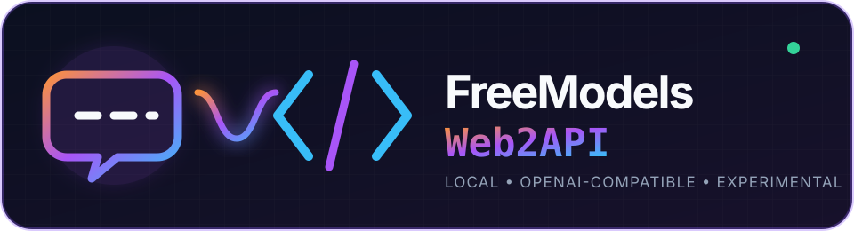
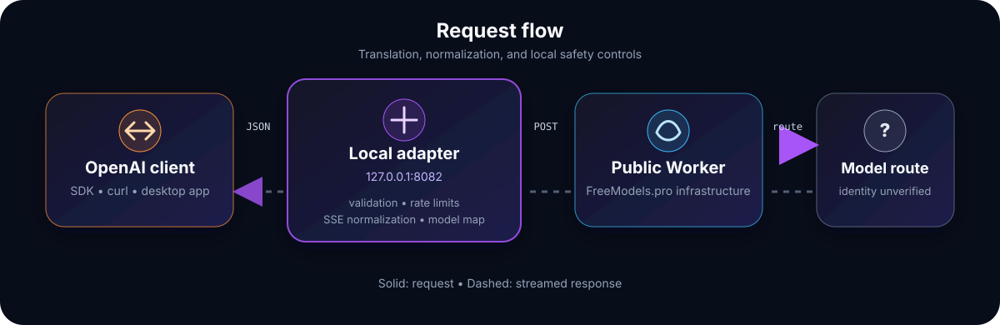

<div align="center">
  

  <p><strong>A cautious, local OpenAI-compatible adapter for the public FreeModels.pro chat interface.</strong></p>

  <p>
    <a href="https://github.com/malikmuhammadsaadshafiq-dev/freemodels-web2api/actions/workflows/test.yml"></a>
    
    <a href="LICENSE"></a>
    
  </p>
</div>

> [!IMPORTANT]
> This is an unofficial interoperability experiment. It is not affiliated with
> FreeModels.pro or any model provider. A displayed model name is not proof of
> the upstream model that served a request. Do not expose this adapter as a
> public relay, resell the upstream service, or use it to evade upstream limits.

## What it does

FreeModels Web2API accepts familiar OpenAI Chat Completions requests, translates
them to the request format used by the public FreeModels.pro web client, and
normalizes its Server-Sent Events back into OpenAI-compatible responses.

<div align="center">
  
</div>

The project is deliberately small: one Python module, one runtime dependency,
and no browser cookies, provider credentials, account rotation, or proxy
rotation.

### Highlights

- OpenAI-compatible `GET /v1/models`
- OpenAI-compatible `POST /v1/chat/completions`
- Streaming and non-streaming output
- Support for the web client's `thinking` and `deep_search` switches
- OpenAI Python SDK, curl, and compatible desktop-client support
- Loopback-only default binding
- Request-size, context, rate, and concurrency guardrails
- Public binding refused unless a local API key is configured (or explicitly bypassed)

## Quick start

### 1. Install

```powershell
git clone https://github.com/malikmuhammadsaadshafiq-dev/freemodels-web2api.git
cd freemodels-web2api
python -m venv .venv
.\.venv\Scripts\Activate.ps1
python -m pip install -e .
```

On macOS or Linux, activate the environment with:

```bash
source .venv/bin/activate
```

### 2. Start the adapter

```powershell
freemodels-web2api
```

The server listens at `http://127.0.0.1:8082`.

### 3. Send a request

```powershell
$body = @{
  model = "gpt-5.6-terra"
  messages = @(
    @{ role = "user"; content = "Reply with exactly OK" }
  )
} | ConvertTo-Json -Depth 5

Invoke-RestMethod `
  -Uri "http://127.0.0.1:8082/v1/chat/completions" `
  -Method Post `
  -ContentType "application/json" `
  -Body $body
```

---

## Docker & Easypanel Deployment

### Deploy cu Docker

```bash
# Build & run container
docker build -t freemodels-web2api .
docker run -d -p 8082:8082 -e LOCAL_API_KEY="cheia-ta-secreta" --name freemodels-web2api freemodels-web2api
```

Sau cu `docker-compose`:

```bash
LOCAL_API_KEY="cheia-ta-secreta" docker compose up -d
```

### Deploy in Easypanel

1. În **Easypanel**, creează un nou serviciu (**App** / **Service**).
2. Sursa: **GitHub / Git Repository** (link către acest repo).
3. Build Type: **Dockerfile** (selectează automat fișierul `Dockerfile`).
4. Setează portul containerului: **8082**.
5. În secțiunea **Environment**, adaugă:
   - `LOCAL_API_KEY`: o cheie secretă (ex: `sk-local-123456`)
   - `PORT`: `8082`
   - `HOST`: `0.0.0.0`
   *(Opțional: dacă nu dorești autentificare cu cheie, setează `ALLOW_UNPROTECTED_BIND=true`)*.
6. Apasă **Deploy**.

---

## OpenAI SDK

Install the optional SDK dependency with `python -m pip install -e ".[sdk]"`,
then use the adapter like any other OpenAI-compatible endpoint:

```python
from openai import OpenAI

client = OpenAI(
    base_url="http://127.0.0.1:8082/v1",
    api_key="local-test",  # Required by the SDK; ignored unless LOCAL_API_KEY is set.
)

response = client.chat.completions.create(
    model="gpt-5.6-terra",
    messages=[{"role": "user", "content": "Explain recursion briefly."}],
)

print(response.choices[0].message.content)
```

For streaming:

```python
stream = client.chat.completions.create(
    model="glm-5.2",
    messages=[{"role": "user", "content": "Write one sentence about space."}],
    stream=True,
)

for chunk in stream:
    text = chunk.choices[0].delta.content
    if text:
        print(text, end="", flush=True)
```

A complete example is available in [`examples/openai_client.py`](examples/openai_client.py).

## API

### Endpoints

| Method | Path | Purpose |
| --- | --- | --- |
| `GET` | `/health` | Local health and version information |
| `GET` | `/v1/models` | Available display labels |
| `POST` | `/v1/chat/completions` | Chat completion, optionally streamed |

### Model labels

| Public model ID | FreeModels.pro web-client ID |
| --- | --- |
| `claude-sonnet-5` | `claude-sonnet-5` |
| `claude-fable-5` | `claude-fable-5` |
| `claude-fable-5.1` | `claude-fable-5.1` |
| `gpt-5.6-sol` | `sol` |
| `gpt-5.6-terra` | `terra` |
| `glm-5.2` | `glm-5.2` |
| `kimi-k3` | `kimi-k3` |

These are UI labels, not cryptographic or provider-issued model attestation. The
upstream service controls their real mapping and may change it without notice.

### Extension fields

The adapter recognizes two optional top-level request fields:

```json
{
  "thinking": true,
  "deep_search": false
}
```

All upstream calls use streaming internally. Non-streaming OpenAI requests are
assembled into one standard `chat.completion` response.

## Configuration

| Environment variable | Default | Description |
| --- | ---: | --- |
| `LOCAL_API_KEY` | unset | Required before binding beyond loopback |
| `ALLOW_UNPROTECTED_BIND` | `false` | Set `true` to allow `0.0.0.0` without `LOCAL_API_KEY` |
| `HOST` | `127.0.0.1` | Host to bind server to |
| `PORT` | `8082` | Port to listen on |
| `MAX_REQUESTS_PER_MINUTE` | `10` | Per-client local request limit |
| `MAX_CONCURRENCY` | `2` | Maximum simultaneous upstream generations |
| `MAX_BODY_BYTES` | `262144` | Maximum incoming JSON body size |
| `MAX_MESSAGES` | `40` | Maximum messages per request |
| `MAX_TOTAL_CHARS` | `60000` | Maximum text characters across messages |
| `UPSTREAM_TIMEOUT_SECONDS` | `120` | Overall upstream timeout |
| `FREEMODELS_UPSTREAM_URL` | public Worker URL | Override primarily intended for tests |

Example with local authentication:

```powershell
$env:LOCAL_API_KEY = "replace-with-a-long-random-secret"
freemodels-web2api --host 0.0.0.0 --port 8082
```

Even with a key, public deployment is discouraged: doing so may create an open
relay, consume shared upstream capacity, and violate upstream policies.

## Safety and privacy

- Prompts pass through this adapter, FreeModels.pro infrastructure, and its
  selected upstream provider. Do not submit secrets or sensitive personal data.
- The adapter does not persist prompts or responses, but infrastructure outside
  this repository may have separate logging and retention practices.
- CORS is intentionally not enabled. CORS is not authentication.
- The project does not include identity rotation, CAPTCHA bypass, cookie
  extraction, provider-key discovery, or rate-limit evasion.
- Review the current [FreeModels.pro terms](https://freemodels.pro/terms) and
  [privacy policy](https://freemodels.pro/privacy) before use.

See [`SECURITY.md`](SECURITY.md) for reporting vulnerabilities.

## Limitations

- The upstream endpoint is undocumented and may disappear or change at any time.
- Only Chat Completions and model listing are implemented.
- Tool calling, images, audio, and the Responses API are not implemented.
- Token usage and cost fields originate upstream and should not be treated as
  audited billing information.
- This project cannot verify which underlying model generated a response.

## Development

```powershell
python -m pip install -e .
python -m unittest discover -s tests -v
python -m py_compile .\freemodels_web2api.py
```

Pull requests are welcome when they preserve the project's local-first and
responsible-use boundaries. Read [`CONTRIBUTING.md`](CONTRIBUTING.md) first.

## License

Released under the [MIT License](LICENSE). The license covers this repository's
source code only; it grants no rights to third-party services, model names, or
trademarks.